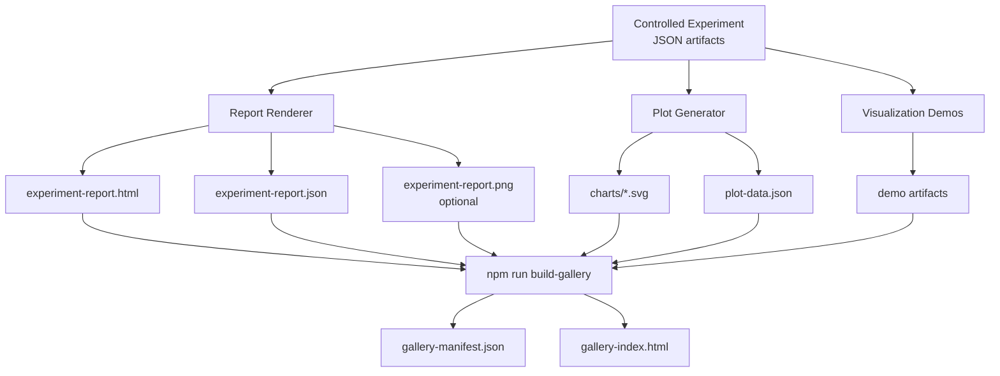
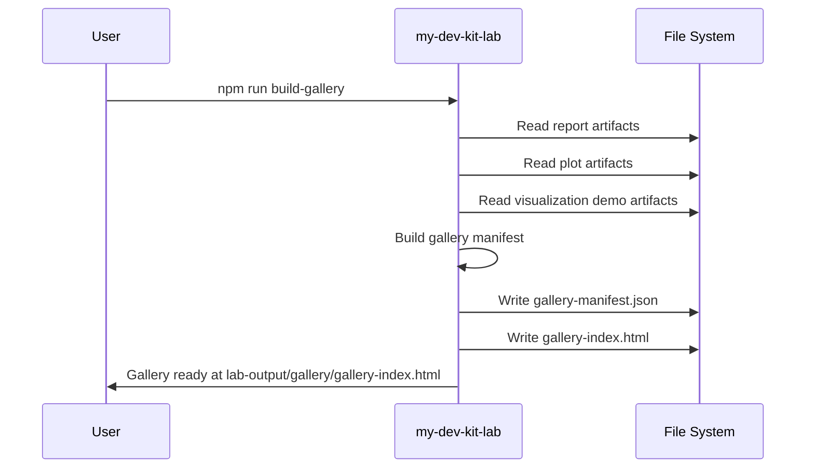

# Gallery

The gallery is a static, browsable index of evidence produced by a my-dev-kit-lab experiment. It links reports, SVG charts, visualization demos, and optional screenshots without copying or reinterpreting their contents.

---

## What the gallery contains

A gallery output directory contains:

| Artifact | Description |
|---|---|
| `gallery-manifest.json` | Structured list of all gallery entries with paths, types, and metadata |
| `gallery-index.html` | Static HTML page linking to all gallery entries |

The gallery manifest references artifacts from:
- The experiment report (`experiment-report.html`, `experiment-report.json`, optional `experiment-report.png`)
- SVG charts from the plot generator (`charts/*.svg`)
- Visualization demo artifacts
- Any additional screenshots captured during the pipeline

Tutorial runs also produce a separate `tutorial-manifest.json`, WebM, screenshots, subtitles, and Markdown. The v0.9.3 release adds read-only tutorial-manifest consumption through `gallery build --source`; tutorial execution remains independent of gallery generation.

---

## How the gallery relates to other outputs



---

## Gallery manifest structure

The `gallery-manifest.json` file lists every artifact in the gallery. Each entry includes:

- **type** — the artifact type: `report`, `plot`, `screenshot`, `demo`, or `index`
- **path** — relative path to the artifact file
- **label** — human-readable label for the gallery index
- **metadata** — additional context such as experiment name, agent, strategy, or complexity level

---

## How to build a gallery

Prerequisites:

- a rendered experiment report
- generated plot artifacts
- visualization artifacts when included

Build the gallery with:

```bash
npm run build-gallery -- \
  --report lab-output/experiment-report-fake \
  --plots lab-output/experiment-plots \
  --visualizations lab-output/visualization-demos \
  --out lab-output/gallery
```

Open `lab-output/gallery/gallery-index.html` in a browser to browse all artifacts.

If the command reports a missing input, generate that artifact first or remove the corresponding optional input. Completion means `gallery-manifest.json` and `gallery-index.html` exist and every relative link resolves from the gallery directory.

---

## Browsing completed outputs with `--source` (v0.9.3 release)

`gallery build --source <path>` (repeatable) adds items for completed experiment, audit, security, Android validation and tutorial outputs. The gallery stays a static artifact browser: it never runs an experiment, audit, security validation or tutorial, never records or transcodes media, and never executes artifact content.

The v0.9.3 release also recognizes `prompt-template-comparison.json` by its schema and links its JSON, HTML and text artifacts when available. Comparison eligibility and evidence limits are documented in [WORKFLOWS.md](WORKFLOWS.md#prompt-template-comparison-v093-release); a gallery `pass` status does not independently validate scientific comparability.

- **Status.** Item `status` keeps the existing `pass`/`skipped`/`warning` vocabulary and reflects only what the producer recorded. The producer's own status (for a tutorial, `run.status`) is shown separately as a metric. A tutorial run that did not pass is never shown as passed, and a report without a recorded exit or verdict is a warning, not a pass.
- **Tutorial runs.** The canonical `artifacts/tutorial-manifest.json` (`schemaVersion` `1.0.0`) supplies title, run identity, status, warnings and cleanup errors. A WebM video is embedded with controls and `preload="metadata"` (never autoplay), PNG/JPEG/WebP screenshots are shown as images, and the generated Markdown is linked as a file and never rendered as HTML. A missing optional artifact is listed as unavailable with a reason.
- **Links.** A referenced file must be a run-root-relative POSIX path that resolves, after symlink/junction resolution, to an ordinary supported file inside its source root, and its content must match its media type. Links are relative to the gallery directory and may begin with `../`; unsafe or unsupported references produce no link.
- **Manifest.** New items may carry the optional `sourceFamily`, `sourceId`, `videoPath`, `markdownPath` and `screenshotPaths` fields. Existing fields and `gallery-manifest.json` structure are unchanged, and `htmlPath` is `""` when a source has no HTML report.

---

## Gallery publishing diagram



---

## Gallery in the final demo

The `npm run run-final-demo` command builds the gallery automatically as the last step of the pipeline. The gallery output is written to the same directory as all other final demo artifacts.

---

## Warm-index campaign gallery (v0.5.2, released)

Available in the installed v0.5.2 CLI (`src/gallery/writeWarmIndexCampaignGallery.ts`). Unlike an ordinary `warm-index-reuse` run, a `--campaign` run that completes automatically produces its own bounded gallery — there is no separate `gallery build` invocation for it, and it does not reuse the generic `writeExperimentGalleryManifest()` contract, whose artifact names (`experiment-report.html`, `experiment-summary.json`, `experiment-runs.json`) do not match the warm-index plugin's own frozen artifact set.

The campaign gallery contains exactly three items, in this order:

1. `warm-index-campaign-report` — the campaign report (`report.html`/`report.json`/`report.txt`), tagged with the campaign agent id, with a screenshot when one was captured.
2. `warm-index-campaign-plots` — the same four warm-index charts (amortized index build cost, context size, correctness, cumulative token usage) as an ordinary warm-index run.
3. `warm-index-execution` — the bounded `warm-index-execution.json` execution evidence.

All paths in the manifest are relative POSIX paths under the gallery output directory; the manifest links to no raw agent stdout/stderr/telemetry file. The report item's status is `pass` only when the report screenshot was actually captured; a skipped or failed screenshot is recorded as a warning on that item rather than failing the gallery.

## Current limitations

- The gallery index is a static HTML file with no interactive filtering or search
- Gallery entries are linked by relative path; moving the output directory breaks links
- Filtering, tagging, search, and comparison views are not implemented
- Filtering, tagging, search, and comparison views remain future scope.
- Security, audit, and Android producers write JSON/text rather than HTML, so their gallery entries link to available artifacts only; no HTML report is synthesized.
- Plugin-report gallery entries expose limited metadata. Legacy experiment reports continue to use the historical `--report` input rather than `--source` schema recognition.
- Media validation checks supported extensions and header bytes. A media file on another drive from the gallery output may be unavailable because durable links remain relative; WebP/JPEG checks do not decode the full media stream.
- The released affected-neighborhood evidence adds no gallery item and no plot. It appears only inside the existing warm-index `report.json`/`report.txt`/`report.html` sections, and the four warm-index charts and the three-item warm-index campaign gallery are unchanged.
- An ordinary `warm-index-reuse` run (deterministic fake agent, `v0.5.0`/`v0.5.1`) has no dedicated gallery integration: `gallery build --plots` lists any `charts/*.svg` generically under the experiment-plots entry, and the plugin's `report.json`/`report.html` are not gallery entries for that path. A real-agent warm-index **campaign** run (`--campaign`, released in v0.5.2) is the exception — see "Warm-index campaign gallery" above

See [ROADMAP.md](ROADMAP.md) for the gallery UI roadmap item.
